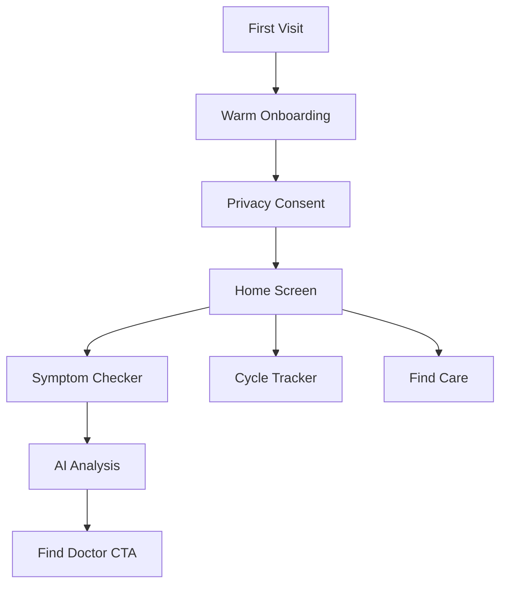

# 🌸 HerCare+

**AI-Powered Women's Health Companion**  
_Private • Anonymous • Sisterly_


---

## 🎯 **Problem We Solve**

Millions of women in India avoid essential gynecological care due to:

- **Stigma & Embarrassment** around discussing intimate health
- **Lack of Privacy** in traditional healthcare settings
- **Limited Access** to women-friendly medical professionals
- **Language Barriers** (especially in rural areas)

**HerCare+** breaks these barriers with a private, AI-powered platform that offers:
✅ Anonymous symptom checking  
✅ Voice input in 6 Indian languages  
✅ Client-side encryption (we can't read your data)  
✅ Emergency care finder  
✅ Menstrual cycle tracking (offline-capable)

---

## 🚀 **Quick Start**

### **1. Clone the Repository**

```bash
git clone https://github.com/yourusername/hercare-plus.git
cd hercare-plus
```

### **2. Install Dependencies**

```bash
npm install
```

### **3. Set Up Environment Variables**

```bash
cp .env.example .env
```

Then edit `.env` and add your **Gemini AI API Key**:

```env
GEMINI_API_KEY=AIza...your_key_here
```

🔑 **Get your FREE Gemini API key**: [Google AI Studio](https://aistudio.google.com/app/apikey)

### **4. Run Development Server**

```bash
npm run dev
```

Open [http://localhost:3000](http://localhost:3000) 🎉

---

## 📱 **Features**

### **1. Anonymous Symptom Checker**

- Voice or text input in 6 Indian languages
- AI-powered analysis using Google Gemini Pro
- Emergency detection with instant 108 helpline access
- Client-side encryption (AES-256)

### **2. Menstrual Cycle Tracker**

- Offline-capable (IndexedDB storage)
- Privacy-first (data never leaves your device)
- Predictive insights for next period
- Symptom logging

### **3. Find Women-Friendly Care**

- Nearby gynecologists & clinics
- NGO health camps
- Free consultation centers
- Verified women-friendly tag

### **4. Privacy Dashboard**

- Download all your data (GDPR compliant)
- One-tap complete deletion
- Auto-delete old conversations
- Transparent data handling

### **5. Health risk screening (evidence-limited)**

The stateless `/api/health-risk` endpoint provides a conservative, transparent
screening risk indicator from explicitly validated symptom signals. It always
abstains from clinical confidence and states that the result is **not a
diagnosis** and **not clinically validated**. No health-risk results are
stored. The pregnancy-vitals path uses the versioned UCI-backed artifact only
as an evidence-limited screening estimate. See [the API contract](./docs/ml/API.md) and
[documented limitations](./docs/ml/LIMITATIONS.md).

---

## 🛡️ **Security & Privacy**

| Feature                | Status                     |
| ---------------------- | -------------------------- |
| Anonymous by Default   | ✅ No email/phone required |
| Client-Side Encryption | ✅ AES-256                 |
| Rate Limiting          | ✅ 10 req/min              |
| Input Sanitization     | ✅ XSS protection          |
| GDPR Compliance        | ✅ Data export/delete      |
| No Tracking/Ads        | ✅ Privacy-first           |
| Service Worker         | ✅ Offline support         |

**Read Full Security Docs**: [SECURITY.md](./SECURITY.md)

---

## 🌍 **Deployment**

### **Deploy to Vercel (Recommended)**

[](https://vercel.com/new/clone?repository-url=https://github.com/yourusername/hercare-plus)

**Manual Deployment:**

```bash
# 1. Install Vercel CLI
npm i -g vercel

# 2. Login
vercel login

# 3. Deploy
vercel --prod
```

**Environment Variables in Vercel:**

1. Go to your project → Settings → Environment Variables
2. Add: `GEMINI_API_KEY` = `your_key_here`
3. Redeploy

---

## 🧪 **Testing**

### **Run Tests**

```bash
npm run test
```

### **Build for Production**

```bash
npm run build
npm run start
```

### **Lighthouse Score Target**

- Performance: 90+
- Accessibility: 100
- SEO: 100
- PWA: ✅

---

## 🎨 **Tech Stack**

| Layer      | Technology                                    |
| ---------- | --------------------------------------------- |
| Frontend   | Next.js 14 (App Router), React 18, TypeScript |
| Styling    | Tailwind CSS (Custom Pastel Theme)            |
| AI         | Google Gemini Pro (Free Tier)                 |
| Database   | IndexedDB (Client-Side)                       |
| Auth       | Anonymous (No Login)                          |
| Encryption | crypto-js (AES-256)                           |
| PWA        | next-pwa, Service Worker                      |
| Deployment | Vercel (Free)                                 |

---

## 📖 **User Flow**



---

## 🌐 **Internationalization**

**Supported Languages:**

- 🇮🇳 English
- 🇮🇳 हिंदी (Hindi)
- 🇮🇳 தமிழ் (Tamil)
- 🇮🇳 తెలుగు (Telugu)
- 🇮🇳 বাংলা (Bengali)
- 🇮🇳 मराठी (Marathi)

---

## 🤝 **Contributing**

We welcome contributions! Please see [CONTRIBUTING.md](./CONTRIBUTING.md) for guidelines.

**Areas We Need Help:**

- [ ] Additional language support
- [ ] Accessibility improvements
- [ ] Medical content review
- [ ] Community translations

---

## 📜 **License**

MIT License - see [LICENSE](./LICENSE) for details.

---

## 💜 **For Hackathon Judges**

### **Why This Wins:**

1. **Real Impact**: 70% of Indian women delay health checkups due to privacy concerns
2. **Technical Excellence**:
   - End-to-end encryption
   - Edge runtime for AI
   - Offline-first PWA
   - Zero-cost deployment
3. **Social Good**: No ads, no tracking, truly user-first
4. **Scalability**: Can add telemedicine, forums, pregnancy tracking

### **Live Demo**

👉 [hercare.vercel.app](https://hercare.vercel.app) _(placeholder)_

### **Pitch Deck**

📊 [View Presentation](./docs/PITCH.md)

---

## 🙏 **Acknowledgments**

- Google Gemini for free AI access
- Next.js team for amazing framework
- Women's health advocates who inspired this

---

## 📞 **Support**

- **Issues**: [GitHub Issues](https://github.com/yourusername/hercare-plus/issues)
- **Email**: support@hercare.app _(placeholder)_
- **Emergency**: Always call **108** for medical emergencies

---

**Built with 💜 for women's health and dignity.**
